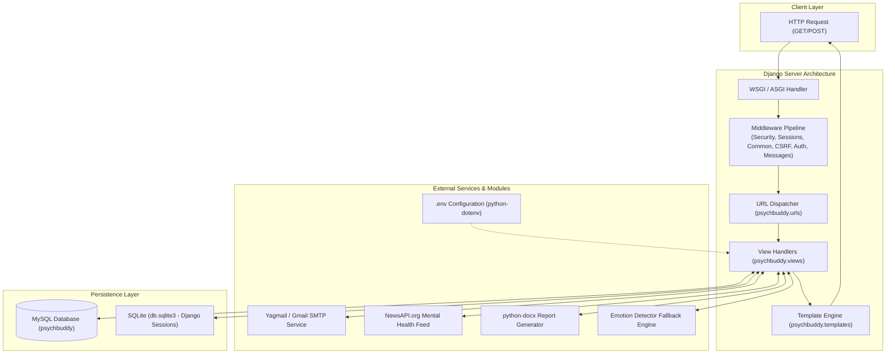
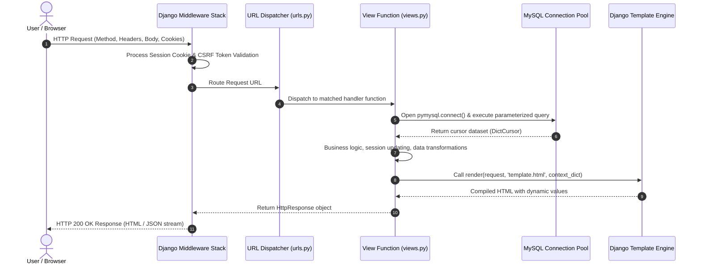
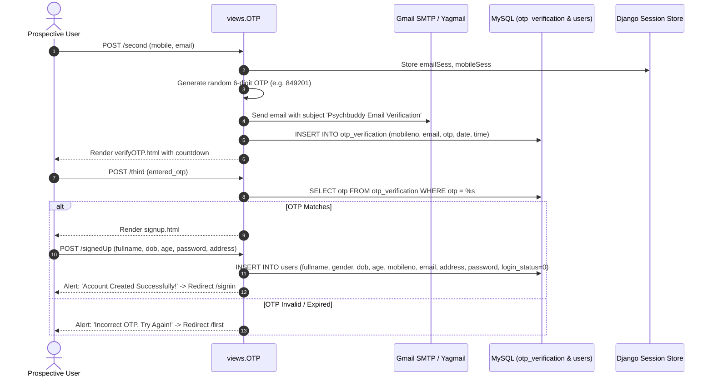
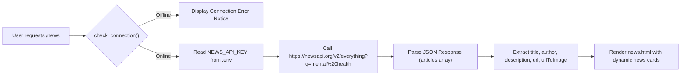
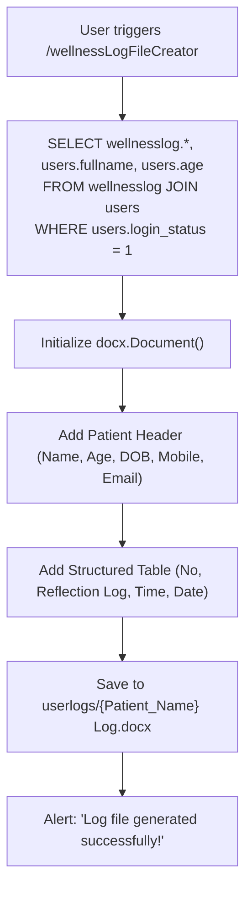
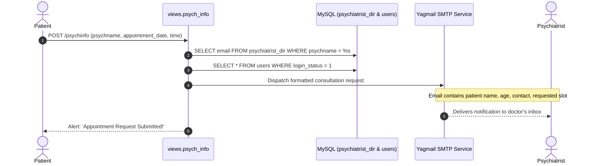
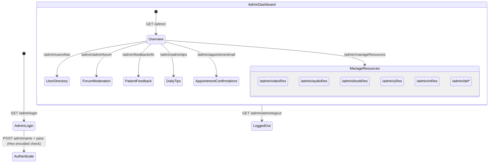

# ⚙️ Backend Architecture & Workflow Specification

This document details the backend architecture, HTTP request-response lifecycle, authentication mechanics, external integrations, view handlers, and admin operations of the **PsychBuddy** web application.

---

## 1. 🏗️ High-Level Backend Architecture

PsychBuddy's backend is implemented using **Python 3.10+** and the **Django Framework**. It decouples Django's built-in session engine from application-specific data access using **PyMySQL**, interacting directly with the **MySQL / MariaDB** database.

---

## 2. 🔄 Request-Response Processing Lifecycle

Every HTTP request received by PsychBuddy undergoes the following deterministic sequence:

---

## 3. 🔐 Authentication & Email OTP Workflow

User registration employs a multi-step verification protocol to ensure verified email addresses:

---

## 4. 🌐 External Service Integrations

### 4.1 📰 NewsAPI Mental Health Feed (`views.news_view`)
Fetches up-to-the-minute clinical studies, news, and mental health advancements:

---

### 4.2 📑 Clinical Docx Report Generator (`views.wellnessLogFileCreator`)
Constructs formatted Microsoft Word documents summarizing patient wellness journals for therapists:

---

### 4.3 📅 Doctor Appointment Notification Dispatcher (`views.psych_info`)
Notifies psychiatrists immediately via automated email when patients request consultations:

---

## 5. 🛡️ Admin Operations Workflow

The admin dashboard provides authenticated operators with complete content publishing and moderation capabilities:

---

## 6. 📋 Complete Backend Routing Directory

| URL Pattern | HTTP Method | Handler Function | Purpose |
| :--- | :--- | :--- | :--- |
| `/` | `GET` | `views.index` | Public landing page |
| `/first` | `GET/POST` | `views.email` | Registration start / email input |
| `/second` | `POST` | `views.OTP` | Generates & sends OTP via SMTP |
| `/third` | `POST` | `views.otpVerify` | Verifies submitted 6-digit OTP |
| `/signedUp` | `POST` | `views.signupUser` | Inserts new user record into database |
| `/signin` | `GET/POST` | `views.signin` | Authenticates user & activates session |
| `/homepage` | `GET` | `views.homePage` | Authenticated dashboard |
| `/psychiatrist` | `GET` | `views.psychiatrist` | Doctor directory |
| `/psychinfo` | `POST` | `views.psych_info` | Doctor details & booking mailer |
| `/relaxation` | `GET` | `views.audio_therapy` | Audio therapy tracks |
| `/books` | `GET` | `views.books` | Reading resources & e-books |
| `/YM` | `GET` | `views.YandM` | Yoga postures & meditation guides |
| `/sessions` | `GET` | `views.sessions` | Video sessions landing catalog |
| `/individualtherapy` | `GET` | `views.individual_therapy`| Individual video therapy player |
| `/grouptherapy` | `GET` | `views.group_therapy` | Group video therapy player |
| `/coupletherapy` | `GET` | `views.couple_therapy` | Couples therapy player |
| `/familytherapy` | `GET` | `views.family_therapy` | Family therapy player |
| `/heartbrokentherapy`| `GET` | `views.heartbroken_therapy`| Heartbreak therapy player |
| `/traumatherapy` | `GET` | `views.trauma_therapy` | Trauma recovery video player |
| `/wellnessLog` | `GET/POST` | `views.wellnessLog` | Log daily emotional reflection |
| `/wellnesslogdir` | `GET` | `views.wellnessLogDir` | Display emotional history timeline |
| `/wellnessLogFileCreator`|`GET`| `views.wellnessLogFileCreator`| Export Word report for therapist |
| `/myforum` / `/forum` | `GET/POST` | `views.chatForum` | Community forum messaging |
| `/news` | `GET` | `views.news_view` | NewsAPI mental health feed |
| `/tips` | `GET` | `views.tips` | Emotion-based advice |
| `/feedback` | `GET/POST` | `views.feedback` | Submit patient reviews |
| `/adminlogin` | `GET/POST` | `views.adminLogin` | Administrator authentication |
| `/admin/` | `GET` | `views.admindashboard` | Admin control panel |
| `/admin/manageResources`|`GET` | `views.manageResources` | Resource management navigation |
| `/admin/videoRes` | `GET/POST` | `views.videoResourcesUpload` | Upload video session files |
| `/admin/audioRes` | `GET/POST` | `views.audioResourcesUpload` | Upload audio therapy MP3s |
| `/admin/bookRes` | `GET/POST` | `views.bookResourcesUpload` | Upload books (PDF & cover art) |
| `/admin/yRes` | `GET/POST` | `views.yResourcesUpload` | Upload yoga postures & images |
| `/admin/mRes` | `GET/POST` | `views.mResourcesUpload` | Upload meditation guides |
| `/admin/del*` | `GET/POST` | `views.delete*` | Deletion endpoints for resources |
| `/admin/usersNav` | `GET` | `views.usersNav` | View registered user directory |
| `/admin/adminforum` | `GET/POST` | `views.chatAdminForum` | Forum moderation & announcements |
| `/admin/feedbackinfo` | `GET` | `views.feedbackinfo` | Patient feedback inspection |
| `/admin/appointmentmail`|`GET/POST`|`views.fixappointmentmail`| Send appointment confirmation |
| `/admin/admintips` | `GET/POST` | `views.admintips` | Update daily admin announcements |
| `/admin/adminlogout`| `GET` | `views.adminlogout` | Admin session termination |
