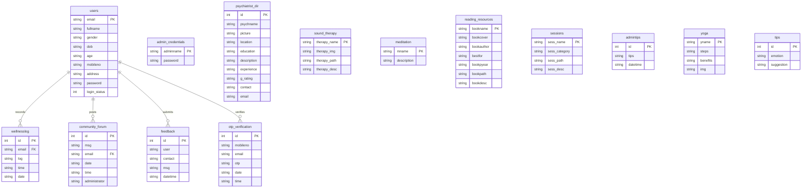
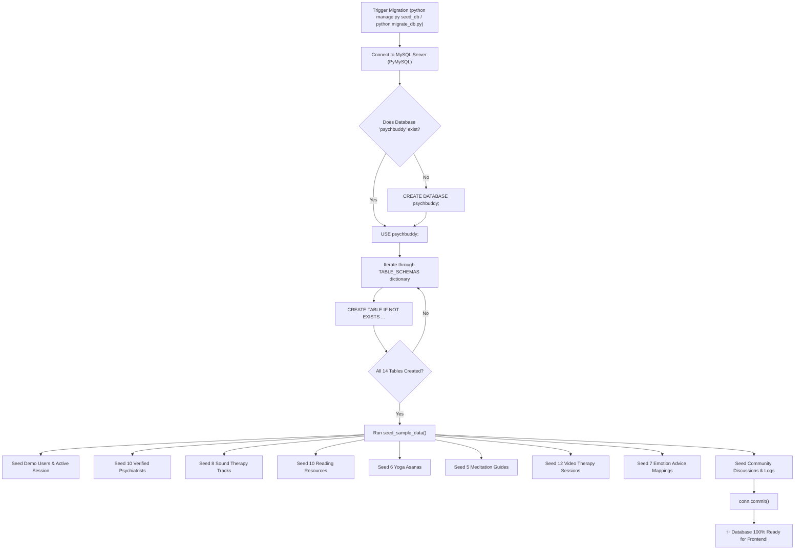

# 🗄️ Database Architecture & Workflow Specification

This document details the database architecture, entity relationships, schema definitions, migration lifecycles, and query access patterns for the **PsychBuddy** MySQL / MariaDB database.

---

## 1. 🏗️ Database Architecture Overview

PsychBuddy utilizes a relational database structure designed for high read throughput, straightforward tabular models, and ACID consistency:

- **Database Engine:** MySQL 8.x / MariaDB 10.4+
- **Default Storage Engine:** `InnoDB`
- **Character Set:** `utf8mb4` (full multi-byte Unicode support for emoji and international characters)
- **Collation:** `utf8mb4_unicode_ci`
- **Default Database Name:** `psychbuddy`
- **Connection Framework:** Direct low-overhead connections via `PyMySQL` with `DictCursor` serialization.

---

## 2. 📊 Entity-Relationship (ER) Diagram

The following diagram illustrates the tables and relational dependencies across the PsychBuddy data model:



---

## 3. 📋 Detailed Schema Catalog

### 3.1 `users` Table
Stores registered patient and visitor profiles.

| Column | Type | Constraints | Description |
| :--- | :--- | :--- | :--- |
| `email` | `VARCHAR(255)` | `PRIMARY KEY` | User's unique login email |
| `fullname`| `VARCHAR(255)` | `NOT NULL` | Full legal name |
| `gender` | `VARCHAR(50)` | `NULL` | Gender identity |
| `dob` | `VARCHAR(50)` | `NULL` | Date of birth (`YYYY-MM-DD`) |
| `age` | `VARCHAR(50)` | `NULL` | Calculated or stated age |
| `mobileno`| `VARCHAR(50)` | `NULL` | Contact phone number |
| `address` | `TEXT` | `NULL` | Physical address / city |
| `password`| `VARCHAR(255)` | `NOT NULL` | User password |
| `login_status`| `INT` | `DEFAULT 0` | `1` if currently active session, `0` otherwise |

---

### 3.2 `psychiatrist_dir` Table
Stores certified doctor and therapist directories for patient discovery and booking.

| Column | Type | Constraints | Description |
| :--- | :--- | :--- | :--- |
| `id` | `INT` | `AUTO_INCREMENT PK` | Internal unique record identifier |
| `psychname` | `VARCHAR(255)` | `NOT NULL` | Full doctor title & name |
| `picture` | `VARCHAR(255)` | `NOT NULL` | Relative path to doctor portrait (`img/psychiatrist/...`) |
| `location` | `VARCHAR(255)` | `NULL` | Clinic location / City |
| `education`| `VARCHAR(255)` | `NULL` | Degrees & certifications (e.g., MD, DPM, MRCPsych) |
| `description`| `TEXT` | `NULL` | Bio and clinical specialties |
| `experience`| `VARCHAR(100)` | `NULL` | Years in clinical practice |
| `g-rating` | `VARCHAR(50)` | `NULL` | Patient review score (e.g., `4.9`) |
| `contact` | `VARCHAR(100)` | `NULL` | Clinic telephone number |
| `email` | `VARCHAR(255)` | `NULL` | Doctor consultation inbox email |

---

### 3.3 `sound_therapy` Table
Catalog of high-bitrate ambient relaxation tracks.

| Column | Type | Constraints | Description |
| :--- | :--- | :--- | :--- |
| `therapy_name` | `VARCHAR(255)` | `NOT NULL` | Track name (e.g., `Ocean Waves`) |
| `therapy_img` | `VARCHAR(255)` | `NOT NULL` | Track poster (`img/sound_img/...`) |
| `therapy_path`| `VARCHAR(255)` | `NOT NULL` | Audio MP3 file path (`audio/...`) |
| `therapy_desc`| `TEXT` | `NULL` | Description of relaxation benefits |

---

### 3.4 `reading_resources` Table
Curated mental health literature, self-help books, and clinical recovery guides.

| Column | Type | Constraints | Description |
| :--- | :--- | :--- | :--- |
| `bookname` | `VARCHAR(255)` | `NOT NULL` | Book title |
| `bookcover`| `VARCHAR(255)` | `NOT NULL` | Book cover image path (`img/books_poster/...`) |
| `bookauthor`| `VARCHAR(255)`| `NOT NULL` | Author name |
| `bestfor` | `VARCHAR(255)` | `NULL` | Recommended mental health focus area |
| `bookpyear`| `VARCHAR(50)` | `NULL` | Year of publication |
| `bookpath` | `VARCHAR(255)` | `NOT NULL` | Downloadable PDF file path (`books/...`) |
| `bookdesc` | `TEXT` | `NULL` | Synopsis and key takeaways |

---

### 3.5 `sessions` Table
Catalog of therapy video courses across individual, group, couple, family, heartbreak, and trauma categories.

| Column | Type | Constraints | Description |
| :--- | :--- | :--- | :--- |
| `sess_name` | `VARCHAR(255)` | `NOT NULL` | Title of therapy session |
| `sess_category`| `VARCHAR(255)`| `NOT NULL` | Therapy category selector |
| `sess_path` | `VARCHAR(255)` | `NOT NULL` | MP4 video relative path (`sessions/...`) |
| `sess_desc` | `TEXT` | `NULL` | Psychological session overview |

---

### 3.6 `wellnesslog` Table
Stores daily patient journaling entries, timestamps, and emotional states.

| Column | Type | Constraints | Description |
| :--- | :--- | :--- | :--- |
| `email` | `VARCHAR(255)` | `NOT NULL` | Foreign reference to `users.email` |
| `log` | `TEXT` | `NOT NULL` | Daily reflective journal entry |
| `time` | `VARCHAR(50)` | `NOT NULL` | Time entry was logged (`HH:MM:SS`) |
| `date` | `VARCHAR(50)` | `NOT NULL` | Date entry was logged (`YYYY-MM-DD`) |

---

### 3.7 `yoga` & `meditation` Tables

- **`yoga`:** `yname` (`VARCHAR(255)`), `steps` (`TEXT`), `benefits` (`TEXT`), `img` (`VARCHAR(255)`).
- **`meditation`:** `mname` (`VARCHAR(255)`), `description` (`TEXT`).

---

## 4. ⚙️ Migration & Seeding Lifecycle Workflow

PsychBuddy includes an automated migration pipeline that eliminates manual SQL schema management:



---

## 5. 🔍 Data Access Patterns & Security

### 5.1 Parameterized Queries (Anti-SQL Injection)
All database interactions in `views.py` and `db_migrator.py` use parameterized placeholders (`%s`) instead of string interpolation:

```python
# Safe, parameterized execution preventing SQL injection:
cursor.execute(
    "SELECT * FROM users WHERE email=%s AND password=%s",
    (email, password)
)
```

### 5.2 Relational Joins for Reporting
For user logs and forum messages, relational joins enrich records dynamically:

```sql
-- Joining user metadata with wellness progress:
SELECT wellnesslog.*, users.fullname, users.age, users.dob, users.mobileno
FROM wellnesslog
JOIN users ON wellnesslog.email = users.email
WHERE users.login_status = 1;
```
