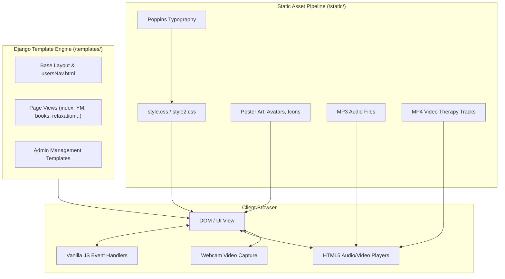
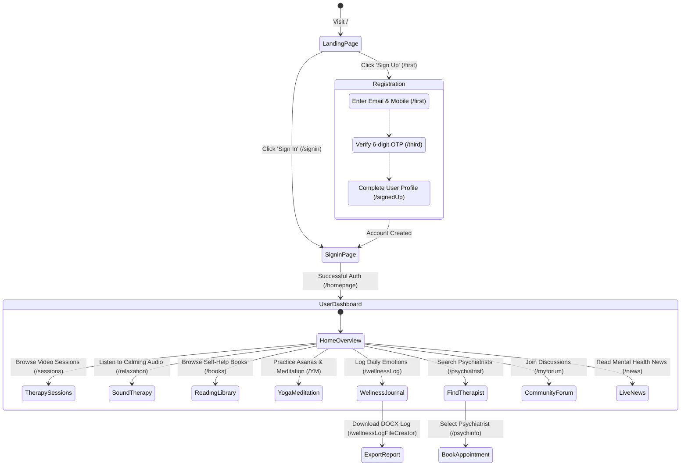
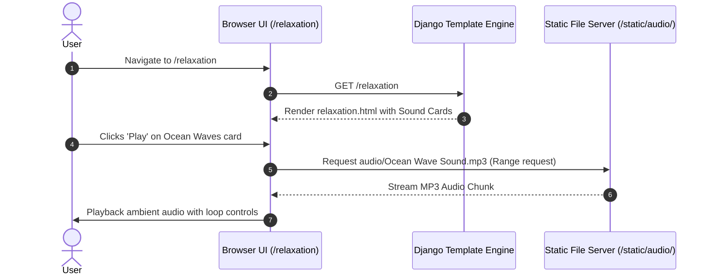
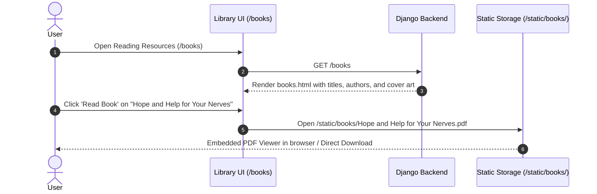
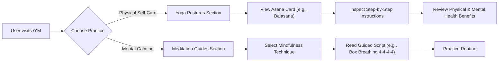
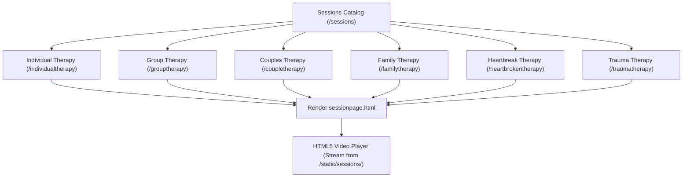
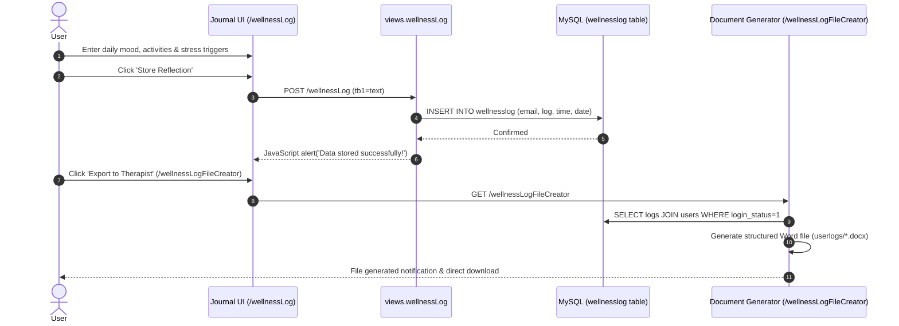

# 🎨 Frontend Architecture & Workflow Specification

This document details the complete frontend architecture, user interaction lifecycles, UI component hierarchy, and rendering workflows of the **PsychBuddy** platform.

---

## 1. 🏗️ High-Level Frontend Architecture

PsychBuddy utilizes server-side rendering powered by the **Django Template Language (DTL)** combined with semantic HTML5, modular CSS3 styling, and modern Vanilla JavaScript for rich client-side interactivity.



---

## 2. 🗺️ End-to-End User Journey Workflow

The following state diagram depicts how users navigate through authentication, onboarding, self-care features, therapy resources, and clinical logging:



---

## 3. 🧩 Core Feature Workflows

### 3.1 🎧 Sound Therapy & Relaxation Player Workflow
Users can stream high-definition ambient nature sounds (ocean waves, rain, nightingale, river stream) without page interruptions:



---

### 3.2 📚 Reading Resources & E-Book Library Workflow
Provides access to curated mental health literature, trauma healing guides, and relationship books:



---

### 3.3 🧘 Yoga & Meditation (YM) Workflow
Guides users through asana routines and mindfulness exercises tailored to stress reduction:



---

### 3.4 🎥 Video Therapy Sessions Workflow
Provides 6 specialized categories of guided psychological video sessions:



---

### 3.5 📝 Daily Mental Wellness Progress Log Workflow
Allows users to write daily reflective logs and export clinical summaries to Word documents for therapists:



---

## 4. 📁 Template Hierarchy & Component Map

```
templates/
├── Base & Navigation
│   ├── index.html                   # Public hero landing page
│   ├── homepage.html                # Authenticated user dashboard
│   ├── usersNav.html                # Reusable navigation bar component
│   └── aboutus.html                 # Mission, team, and contact info
│
├── Authentication & Onboarding
│   ├── emailVerify.html             # Step 1: Email and mobile input
│   ├── verifyOTP.html               # Step 2: 6-digit OTP code input
│   ├── signup.html                  # Step 3: Profile details form
│   └── signin.html                  # User login credentials form
│
├── Mental Wellness Features
│   ├── psychiatrist.html            # Verified doctors directory
│   ├── psychInfo.html               # Doctor bio & booking confirmation
│   ├── relaxation.html              # Sound therapy audio player
│   ├── books.html                   # Reading resources library
│   ├── YM.html                      # Yoga & Meditation routines
│   ├── sessions.html                # Video sessions directory
│   ├── sessionpage.html             # Video category streaming player
│   ├── MentalWellnessLog.html       # Daily emotional log entry form
│   ├── MentalWellnessLogDir.html    # Progress history & export options
│   ├── forum.html / myforum.html    # Peer community discussion board
│   ├── tips.html                    # Personalized emotion advice
│   ├── news.html                    # Real-time mental health news
│   └── feedback.html                # User reviews & suggestions
│
└── Admin Management Portal
    ├── adminlogin.html              # Secure administrator authentication
    ├── admindashboard.html          # Main administrator overview
    ├── manageResources.html         # Resource management center
    ├── videoResAdmin.html           # Video session uploader
    ├── audioResAdmin.html           # Audio therapy uploader
    ├── readingResAdmin.html         # Book & PDF uploader
    ├── yResAdmin.html               # Yoga pose uploader
    ├── mResAdmin.html               # Meditation guide uploader
    ├── delVideoRes.html             # Video session deleter
    ├── delAudioRes.html             # Audio resource deleter
    ├── delBookRes.html              # Book resource deleter
    ├── delYRes.html                 # Yoga pose deleter
    ├── delMRes.html                 # Meditation guide deleter
    ├── adminforum.html              # Community forum moderator
    ├── feedbackinfo.html            # Patient reviews list
    ├── appointmentmail.html         # Appointment confirmation dispatcher
    └── admintips.html               # Administrator daily tips editor
```
