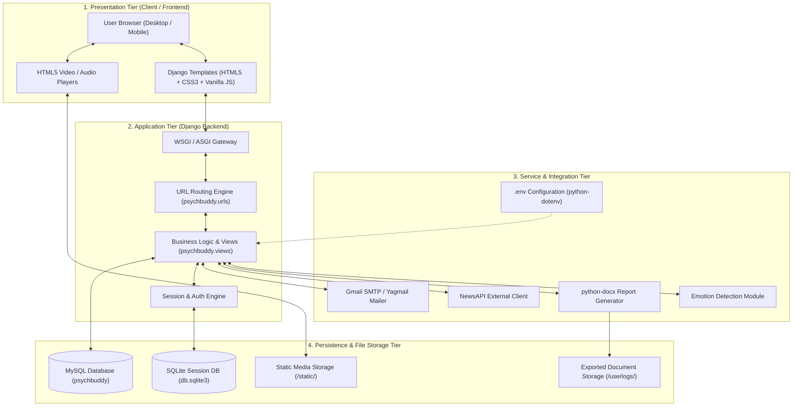
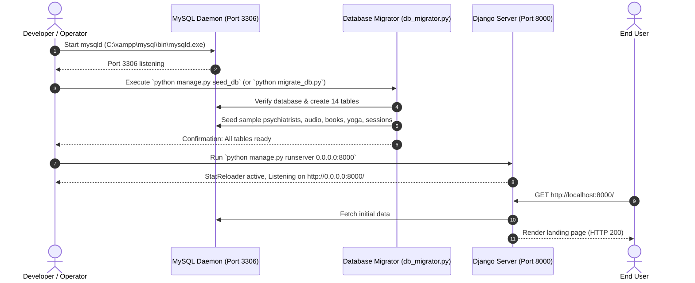
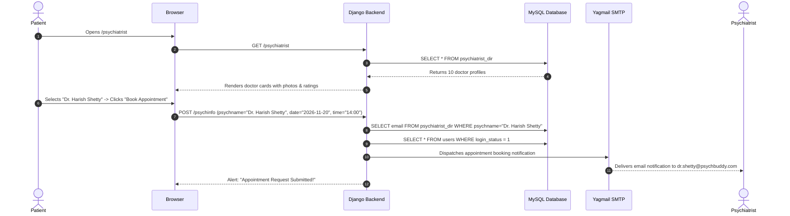
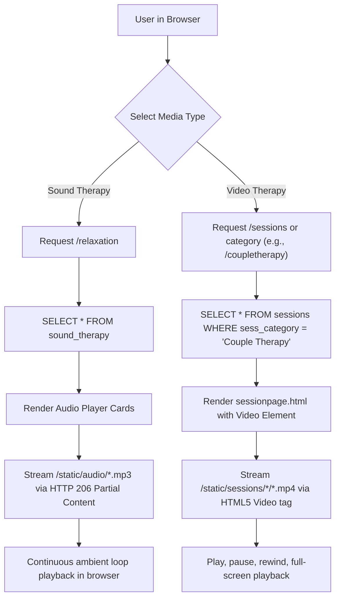
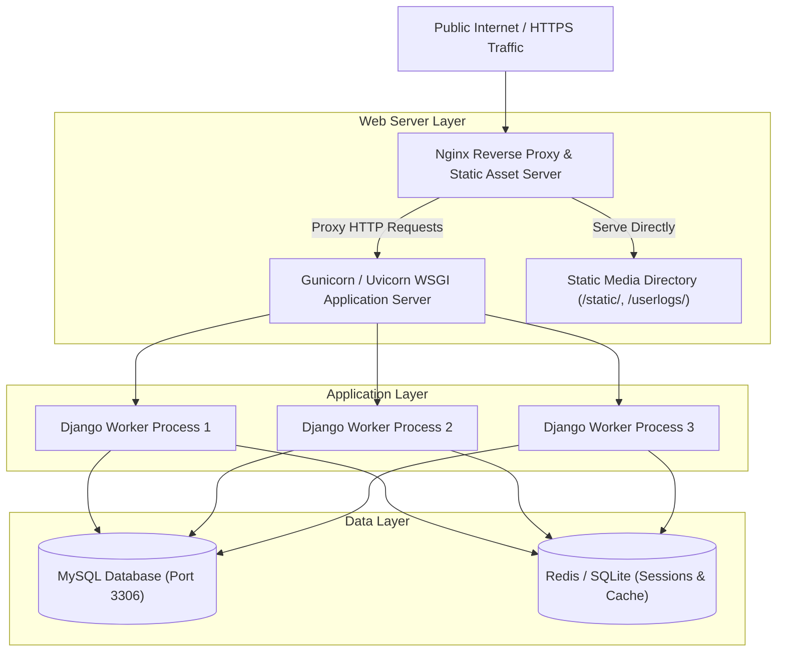

# 🔄 System Integration & End-to-End Operational Workflow

This document details the complete end-to-end operational architecture connecting the **Frontend (Client/Templates)**, **Backend (Django/Python)**, and **Database (MySQL/PyMySQL)** into a cohesive mental health companion platform.

---

## 1. 🏗️ Multi-Tier Architecture Overview



---

## 2. 🚀 System Startup & Initialization Sequence

The following diagram illustrates the proper order of operations to launch the entire stack:



---

## 3. 🎯 Core End-to-End Operational Scenarios

### 3.1 Scenario A: Patient Finds a Psychiatrist and Books an Appointment



---

### 3.2 Scenario B: Multimedia Streaming Workflow (Audio & Video)



---

### 3.3 Scenario C: Daily Journal Reflection & Clinical Report Export

```mermaid
flowchart LR
    A["Patient logs in"] --> B["Opens /wellnessLog"]
    B --> C["Enters daily reflection"]
    C --> D["POST /wellnessLog"]
    D --> E[("INSERT INTO wellnesslog")]
    E --> F["View reflection history on /wellnesslogdir"]
    F --> G["Click 'Export Log' (/wellnessLogFileCreator)"]
    G --> H["Backend joins wellnesslog with user profile"]
    H --> I["python-docx generates formatted .docx"]
    I --> J["Saved in /userlogs/ and downloaded by patient"]
```



---

## 4. 🌐 Production Deployment Architecture

For deploying PsychBuddy in production environments, the recommended industry topology is:



---

## 5. 🛡️ Operational Checklist for Administrators

1. **Environment Secrets:** Never commit `.env` to Git. Ensure `.gitignore` contains `.env`.
2. **Database Backups:** Schedule regular mysqldump snapshots:
   ```powershell
   mysqldump -u root -p psychbuddy > backup_psychbuddy.sql
   ```
3. **Database Migration:** Always run migration on new deployments:
   ```powershell
   python manage.py seed_db
   ```
4. **App Service Monitoring:** Monitor the Django server and MySQL process via system services or task managers.
